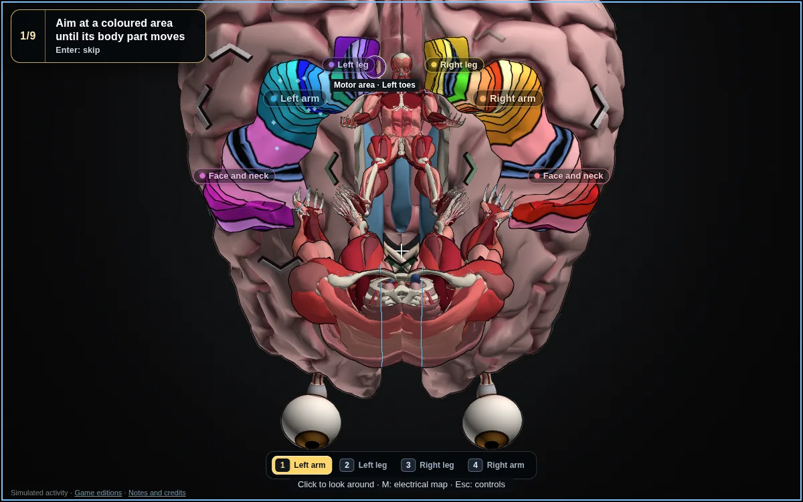

# NeuroSurge

**[Play Full](https://eliminatenoise.github.io/NeuroSurge/scene/example/preview.html) · [Play Lite](https://eliminatenoise.github.io/NeuroSurge/scene/example/preview.html?edition=lite) · [Download Lite offline preview](https://github.com/eliminatenoise/NeuroSurge/releases/download/lite-browser-forecast-2026-11-24/NeuroSurge-Lite.zip) · [Open the game menu](https://eliminatenoise.github.io/NeuroSurge/) · [Download launchers](https://eliminatenoise.github.io/NeuroSurge/START.html)**

**[Play the Movement mirror preview](https://eliminatenoise.github.io/NeuroTranslation/previews/neurosurge/)** · [Full preview](https://eliminatenoise.github.io/NeuroTranslation/previews/neurosurge/scene/example/preview.html) · [Lite preview](https://eliminatenoise.github.io/NeuroTranslation/previews/neurosurge/scene/example/preview.html?edition=lite)

**[Open the interactive project browser](https://eliminatenoise.github.io/NeuroTranslation/projects/?project=neurosurge)** · [Technical index](https://eliminatenoise.github.io/NeuroTranslation/projects/technical.html?project=neurosurge)

[Simple player guide](PLAYER-GUIDE.md) · [Technical player guide](PLAYER-GUIDE-TECHNICAL.md) · [Credits and licences](CREDITS-AND-LICENCES.md)

NeuroSurge is a 3D browser game. Aim at a coloured area of the motor strip, the part of the brain that helps control movement. A body part moves, and a mirror body repeats the movement so you can see it from another angle.

## Choose an edition

| Edition | Anatomy download | Controls and movement |
| --- | --- | --- |
| Full | Standard mesh packs | Shared game |
| Lite | 0.85 to 1.00 MB less data, depending on browser support | Shared game |

Lite uses a smaller file format for the same 3D shapes. After the browser opens those files, both editions have identical anatomy data. A browser without built-in support loads a small decoder with Lite. [Technical details and exact file sizes](lite/README.md).

## Play a local copy

1. [Download the repository ZIP](https://github.com/eliminatenoise/NeuroSurge/archive/refs/heads/main.zip) and extract it.
2. Open a terminal in the extracted folder. With Node.js 18 or later installed, run `node serve-local.mjs`.
3. Open the printed address in a browser with WebGL. Select **Play Full** or **Play Lite**. Leave the terminal open while you play.

[Windows, macOS and Linux Lite launchers](lite/README.md) · [Desktop bookmarks for the hosted game](START.html)

## Scope and reuse

The brain signals, muscle responses and movements are simulated. The game uses a simplified map of movement areas. It does not read anyone’s brain or measure muscle force.

Project code is CC0. The BodyParts3D anatomy is CC BY 4.0, Z-Anatomy derivatives are CC BY-SA 4.0 and Three.js is MIT. The [asset attribution index](ASSET-ATTRIBUTION-INDEX.md) lists the original sources and terms. The [previous Full and Lite trial](https://github.com/eliminatenoise/NeuroSurge/tree/786d60f39c3a046dcb9f65eb856113bbca20942c) remains in Git history.
